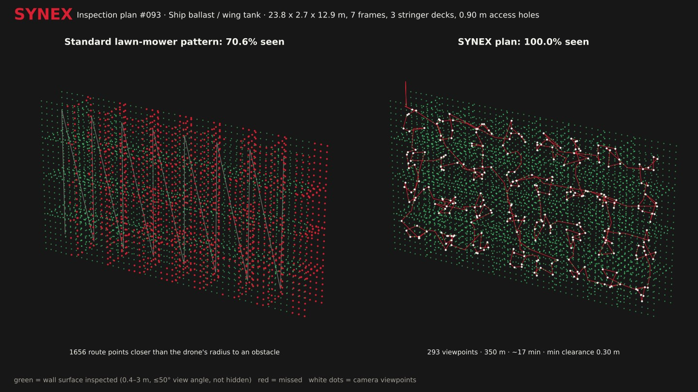
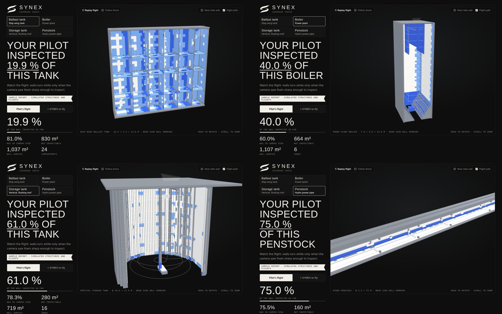
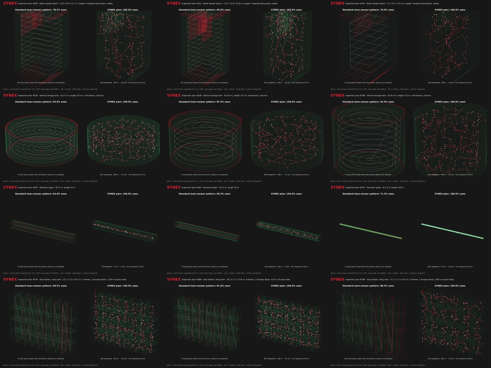

# SYNEX · Inspection flight plans for confined spaces

**From a drawing to a complete drone inspection route in seconds.**
Boilers, storage tanks, penstocks and ship ballast tanks: dark, GPS-less, full of beams, pipes, cables and narrow access holes.
SYNEX computes where the drone must fly, where the camera must look and in which order, so that **every square metre of wall is inspected**, with a safe distance to everything.

## New: Coverage Check, what your footage really inspected

Most confined-space flights end with hours of video and one open question: **was every wall actually inspected, or only flown past?**
SYNEX Coverage Check answers it from the files your drone already records, the point cloud and the flight log, within 24 hours.

**[Open the interactive sample reports](https://mustafabozann.github.io/synex-inspection-plans/report/)**: four confined spaces, each with a drone replaying the pilot's flight inside the structure.

| Structure | Wall surface | Pilot's flight, inspection quality | With SYNEX re-fly | Re-fly |
|---|---|---|---|---|
| Ship wing ballast tank (16.9 × 2.8 × 14.8 m, 24 compartments) | 1,037 m² | 19.9 % | **99.5 %** | 7 flights, ~53 min |
| Power plant boiler (7.0 × 9.0 × 23.6 m) | 1,107 m² | 40.0 % | **92.4 %** | 8 flights, ~55 min |
| Vertical storage tank (Ø 10.6 × 11.0 m) | 719 m² | 61.0 % | **93.4 %** | 3 flights, ~19 min |
| Hydro penstock (Ø 2.5 × 75 m) | 640 m² | 75.0 % | **99.9 %** | 3 flights, ~21 min |

*All four structures and pilot flights are simulated. Where the re-fly result stays below 100 %, the remaining walls cannot be reached with the drone's safety margin; the report lists them instead of hiding them.*

### How to read the report

| Part | What it shows | How it is computed |
|---|---|---|
| **Headline counter** | Share of the wall surface inspected at inspection quality: 19.9 % for the pilot's flight, 99.5 % after re-fly. The drone in the 3D view replays the logged flight; a wall turns white at the moment the camera saw it sharply. | The wall is cut into 0.5 × 0.5 m patches. A patch counts only when **all** of its check points (up to 5) pass. |
| **Colours** | White: inspected. Light blue: in the camera's view, but the image was not sharp enough. Dark blue: never in the camera's view. | "Sharp enough" = at most 1 mm of wall per pixel at the actual viewing angle, motion blur under 1.5 px (moving and turning), and within reach of the drone's lights. All limits are adjustable to your own standard. |
| **Compartments** | One cell per compartment (bay × level) with the share of its walls inspected. Click a cell to fly the 3D view there. | Bays are numbered from the aft end, levels from the bottom. |
| **Wall maps** | The two long walls unfolded flat, like a shell expansion drawing, with the bulkheads (BHD) and stringer decks (STR) as dashed lines. | Same patch results, drawn at true scale. |
| **Re-fly plan** | The extra viewpoints (position and camera angle), grouped into short flights that each fit one battery, with route length and time. | Routes start and end at the manhole and keep the cage radius plus a safety margin from every surface. |
| **Certain / uncertain** | How much of the result still holds if the logged positions are off by 10 cm and 2°. | The flight is re-checked with random position errors; areas whose result changes are added to the re-fly plan. |
| **Viewing angle** | Share of the wall seen at 0–25° (ideal), 25–40° (good) and 40–50° (conditional) off the wall's normal. | Straightest inspection-quality view of each patch. |
| **Provenance** | Software version, date, settings and a SHA-256 fingerprint of every input file. | So any result can be reproduced and audited. |

**What we need from you:** a point cloud of the space (`.las`, `.laz`, `.e57`, `.ply`, ...) and the flight log with camera position and direction (CSV, or a ROS bag). No CAD drawing is needed.

**Accuracy, stated plainly:** on four simulated structures, of the patches the engine called inspected, at most 1.1 % were not fully seen according to the simulator's independent ground truth. It has **not yet been validated on customer field data**; that is what the free trial is for. Full coverage means every wall area was imaged at the stated quality, not that every defect was found: the images are still assessed by a qualified inspector.

**Free trial:** send one past flight you are allowed to share. You get the report within 24 hours, free; we only ask for your honest feedback. Open an [issue](../../issues/new) or reply to our email.

## 100 plans, 100 different structures

| | |
|---|---|
| Plans in this repository | **100** (4 structure types, easy to hard) |
| Wall surface fully covered | **100 / 100** plans |
| Average coverage, SYNEX plan | **100.0%** |
| Average coverage, standard lawn-mower pattern | 85.7% |
| Average planning time | 3.9 s per structure |

| Structure | Plans | SYNEX coverage | Standard pattern | Standard: points too close to obstacles | Avg. viewpoints | Avg. est. flight |
|---|---|---|---|---|---|---|
| Boiler (power plant) | 25 | **100.0%** | 73.2% | 58 per flight (SYNEX: 0) | 192 | 14 min |
| Vertical storage tank | 25 | **100.0%** | 90.6% | 4 per flight (SYNEX: 0) | 168 | 14 min |
| Penstock (pipe) | 25 | **100.0%** | 91.1% | 0 per flight (SYNEX: 0) | 124 | 8 min |
| Ship ballast / wing tank | 25 | **100.0%** | 87.7% | 518 per flight (SYNEX: 0) | 316 | 18 min |

*Left in each image: a standard back-and-forth pattern at a fixed distance from the walls. Right: the SYNEX plan.
Green = wall inspected, red = missed, white dots = camera viewpoints.*

## What you get per structure

- **`plan.png`**: 3D view of the plan next to a standard pattern, with what each one sees and misses.
- **`route.csv`**: the full flight path, every 0.3 m: position (x, y, z in metres), camera yaw and pitch, and which points are inspection viewpoints. Ready to import into a mission planner.
- **`summary.json`**: coverage, number of viewpoints, route length, estimated flight time, minimum clearance to obstacles.

**What "inspected" means here:** a wall patch (0.5 × 0.5 m) counts only if a camera saw it from **0.4 to 3 m away**, at **no more than 50°** off the wall's normal, inside a 90° × 70° field of view, with nothing in between.
The route keeps at least **0.3 m** clearance from every obstacle (beams, tube panels, cables, frames) and enters and leaves through the manhole.

**Estimated flight time** assumes 0.5 m/s and a 1 s stop at every viewpoint.

## Honest status

- All structures here are **generated 3D models** (realistic dimensions and internals, not customer drawings).
- Plans are computed and checked in simulation. **No real flight has been made yet.**
- The "standard pattern" is a simple automatic back-and-forth route at 1.5 m from the walls, used only as a reference. It is not a measurement of any specific pilot or product.
- Coming next: the SYNEX AI pilot that flies these plans by itself, without GPS.

## Try it on your own structure

We are opening a small number of **free test accounts**:
send a drawing, a CAD model or a point cloud of one structure, plus your drone's size and camera, and receive the plan, route file and coverage report.
After the test, plans are priced **per project**.

**Request a test account:** open an [issue in this repository](../../issues/new) with the structure type and your drone size. We will reply there.

---

All 100 plans

| # | Structure | Size | SYNEX | Standard | Viewpoints | Route | Est. flight | Files |
|---|---|---|---|---|---|---|---|---|
| 001 | Boiler (power plant) | 8.6 x 7.9 x 23.7 m, hopper, hanging tube panels, cables | **100.0%** | 80.4% | 149 | 259 m | 11.1 min | [plan](plans/001_boiler/plan.png) · [route](plans/001_boiler/route.csv) · [summary](plans/001_boiler/summary.json) |
| 002 | Boiler (power plant) | 14.0 x 8.1 x 29.8 m, hopper, hanging tube panels, cables | **100.0%** | 79.9% | 255 | 467 m | 19.8 min | [plan](plans/002_boiler/plan.png) · [route](plans/002_boiler/route.csv) · [summary](plans/002_boiler/summary.json) |
| 003 | Boiler (power plant) | 12.9 x 9.9 x 21.7 m, hopper, hanging tube panels, cables | **100.0%** | 78.5% | 209 | 361 m | 15.5 min | [plan](plans/003_boiler/plan.png) · [route](plans/003_boiler/route.csv) · [summary](plans/003_boiler/summary.json) |
| 004 | Boiler (power plant) | 13.6 x 9.1 x 17.5 m, hopper, hanging tube panels, cables | **100.0%** | 72.7% | 199 | 337 m | 14.6 min | [plan](plans/004_boiler/plan.png) · [route](plans/004_boiler/route.csv) · [summary](plans/004_boiler/summary.json) |
| 005 | Boiler (power plant) | 11.8 x 6.7 x 22.9 m, hopper, hanging tube panels, cables | **100.0%** | 80.3% | 176 | 304 m | 13.1 min | [plan](plans/005_boiler/plan.png) · [route](plans/005_boiler/route.csv) · [summary](plans/005_boiler/summary.json) |
| 006 | Boiler (power plant) | 6.3 x 9.1 x 16.5 m, hopper, hanging tube panels, cables | **100.0%** | 88.2% | 91 | 157 m | 6.8 min | [plan](plans/006_boiler/plan.png) · [route](plans/006_boiler/route.csv) · [summary](plans/006_boiler/summary.json) |
| 007 | Boiler (power plant) | 6.0 x 10.7 x 19.9 m, hopper, hanging tube panels, cables | **99.9%** | 60.0% | 227 | 341 m | 15.1 min | [plan](plans/007_boiler/plan.png) · [route](plans/007_boiler/route.csv) · [summary](plans/007_boiler/summary.json) |
| 008 | Boiler (power plant) | 7.9 x 9.1 x 18.9 m, hopper, hanging tube panels, cables | **100.0%** | 71.3% | 153 | 235 m | 10.4 min | [plan](plans/008_boiler/plan.png) · [route](plans/008_boiler/route.csv) · [summary](plans/008_boiler/summary.json) |
| 009 | Boiler (power plant) | 9.3 x 9.6 x 14.2 m, hopper, hanging tube panels, cables | **100.0%** | 67.9% | 145 | 215 m | 9.6 min | [plan](plans/009_boiler/plan.png) · [route](plans/009_boiler/route.csv) · [summary](plans/009_boiler/summary.json) |
| 010 | Boiler (power plant) | 7.4 x 9.6 x 19.7 m, hopper, hanging tube panels, cables | **100.0%** | 84.9% | 126 | 226 m | 9.6 min | [plan](plans/010_boiler/plan.png) · [route](plans/010_boiler/route.csv) · [summary](plans/010_boiler/summary.json) |
| 011 | Boiler (power plant) | 10.6 x 11.8 x 28.1 m, hopper, hanging tube panels, cables | **100.0%** | 75.4% | 297 | 536 m | 22.8 min | [plan](plans/011_boiler/plan.png) · [route](plans/011_boiler/route.csv) · [summary](plans/011_boiler/summary.json) |
| 012 | Boiler (power plant) | 7.4 x 6.4 x 16.9 m, hopper, hanging tube panels, cables | **100.0%** | 73.8% | 111 | 164 m | 7.3 min | [plan](plans/012_boiler/plan.png) · [route](plans/012_boiler/route.csv) · [summary](plans/012_boiler/summary.json) |
| 013 | Boiler (power plant) | 11.0 x 10.9 x 22.8 m, hopper, hanging tube panels, cables | **100.0%** | 69.8% | 252 | 415 m | 18.0 min | [plan](plans/013_boiler/plan.png) · [route](plans/013_boiler/route.csv) · [summary](plans/013_boiler/summary.json) |
| 014 | Boiler (power plant) | 8.6 x 9.5 x 20.5 m, hopper, hanging tube panels, cables | **100.0%** | 72.1% | 203 | 319 m | 14.0 min | [plan](plans/014_boiler/plan.png) · [route](plans/014_boiler/route.csv) · [summary](plans/014_boiler/summary.json) |
| 015 | Boiler (power plant) | 11.1 x 9.0 x 14.5 m, hopper, hanging tube panels, cables | **100.0%** | 67.1% | 159 | 229 m | 10.3 min | [plan](plans/015_boiler/plan.png) · [route](plans/015_boiler/route.csv) · [summary](plans/015_boiler/summary.json) |
| 016 | Boiler (power plant) | 9.9 x 9.4 x 18.3 m, hopper, hanging tube panels, cables | **100.0%** | 58.9% | 243 | 355 m | 15.9 min | [plan](plans/016_boiler/plan.png) · [route](plans/016_boiler/route.csv) · [summary](plans/016_boiler/summary.json) |
| 017 | Boiler (power plant) | 6.4 x 7.9 x 15.4 m, hopper, hanging tube panels, cables | **100.0%** | 71.4% | 104 | 160 m | 7.1 min | [plan](plans/017_boiler/plan.png) · [route](plans/017_boiler/route.csv) · [summary](plans/017_boiler/summary.json) |
| 018 | Boiler (power plant) | 7.6 x 7.3 x 29.9 m, hopper, hanging tube panels, cables | **100.0%** | 77.0% | 189 | 318 m | 13.8 min | [plan](plans/018_boiler/plan.png) · [route](plans/018_boiler/route.csv) · [summary](plans/018_boiler/summary.json) |
| 019 | Boiler (power plant) | 13.3 x 8.3 x 27.9 m, hopper, hanging tube panels, cables | **100.0%** | 72.9% | 303 | 504 m | 21.9 min | [plan](plans/019_boiler/plan.png) · [route](plans/019_boiler/route.csv) · [summary](plans/019_boiler/summary.json) |
| 020 | Boiler (power plant) | 9.3 x 10.7 x 26.7 m, hopper, hanging tube panels, cables | **100.0%** | 70.6% | 292 | 481 m | 20.9 min | [plan](plans/020_boiler/plan.png) · [route](plans/020_boiler/route.csv) · [summary](plans/020_boiler/summary.json) |
| 021 | Boiler (power plant) | 11.5 x 11.0 x 20.8 m, hopper, hanging tube panels, cables | **100.0%** | 61.8% | 305 | 496 m | 21.6 min | [plan](plans/021_boiler/plan.png) · [route](plans/021_boiler/route.csv) · [summary](plans/021_boiler/summary.json) |
| 022 | Boiler (power plant) | 10.3 x 8.0 x 25.3 m, hopper, hanging tube panels, cables | **100.0%** | 91.0% | 147 | 274 m | 11.6 min | [plan](plans/022_boiler/plan.png) · [route](plans/022_boiler/route.csv) · [summary](plans/022_boiler/summary.json) |
| 023 | Boiler (power plant) | 7.5 x 9.5 x 14.3 m, hopper, hanging tube panels, cables | **100.0%** | 76.9% | 106 | 180 m | 7.8 min | [plan](plans/023_boiler/plan.png) · [route](plans/023_boiler/route.csv) · [summary](plans/023_boiler/summary.json) |
| 024 | Boiler (power plant) | 10.1 x 10.1 x 16.5 m, hopper, hanging tube panels, cables | **100.0%** | 55.5% | 232 | 345 m | 15.4 min | [plan](plans/024_boiler/plan.png) · [route](plans/024_boiler/route.csv) · [summary](plans/024_boiler/summary.json) |
| 025 | Boiler (power plant) | 8.9 x 10.0 x 16.0 m, hopper, hanging tube panels, cables | **100.0%** | 70.7% | 128 | 229 m | 9.8 min | [plan](plans/025_boiler/plan.png) · [route](plans/025_boiler/route.csv) · [summary](plans/025_boiler/summary.json) |
| 026 | Vertical storage tank | Ø 10.9 m, height 7.3 m, roof beams, columns | **100.0%** | 81.0% | 71 | 132 m | 5.6 min | [plan](plans/026_tank/plan.png) · [route](plans/026_tank/route.csv) · [summary](plans/026_tank/summary.json) |
| 027 | Vertical storage tank | Ø 19.6 m, height 10.7 m, roof beams, columns | **100.0%** | 93.7% | 191 | 403 m | 16.6 min | [plan](plans/027_tank/plan.png) · [route](plans/027_tank/route.csv) · [summary](plans/027_tank/summary.json) |
| 028 | Vertical storage tank | Ø 27.5 m, height 10.0 m, roof beams, columns | **100.0%** | 92.8% | 307 | 649 m | 26.8 min | [plan](plans/028_tank/plan.png) · [route](plans/028_tank/route.csv) · [summary](plans/028_tank/summary.json) |
| 029 | Vertical storage tank | Ø 27.6 m, height 14.5 m, roof beams, columns | **100.0%** | 93.4% | 370 | 810 m | 33.2 min | [plan](plans/029_tank/plan.png) · [route](plans/029_tank/route.csv) · [summary](plans/029_tank/summary.json) |
| 030 | Vertical storage tank | Ø 17.1 m, height 15.1 m, roof beams, columns | **100.0%** | 94.0% | 195 | 413 m | 17.0 min | [plan](plans/030_tank/plan.png) · [route](plans/030_tank/route.csv) · [summary](plans/030_tank/summary.json) |
| 031 | Vertical storage tank | Ø 13.9 m, height 11.4 m, roof beams, columns | **100.0%** | 88.5% | 123 | 250 m | 10.4 min | [plan](plans/031_tank/plan.png) · [route](plans/031_tank/route.csv) · [summary](plans/031_tank/summary.json) |
| 032 | Vertical storage tank | Ø 14.6 m, height 15.3 m, roof beams, columns | **100.0%** | 94.7% | 156 | 302 m | 12.7 min | [plan](plans/032_tank/plan.png) · [route](plans/032_tank/route.csv) · [summary](plans/032_tank/summary.json) |
| 033 | Vertical storage tank | Ø 19.4 m, height 6.0 m, roof beams, columns | **100.0%** | 92.2% | 147 | 286 m | 12.0 min | [plan](plans/033_tank/plan.png) · [route](plans/033_tank/route.csv) · [summary](plans/033_tank/summary.json) |
| 034 | Vertical storage tank | Ø 10.6 m, height 8.4 m, roof beams, columns | **100.0%** | 88.3% | 72 | 127 m | 5.4 min | [plan](plans/034_tank/plan.png) · [route](plans/034_tank/route.csv) · [summary](plans/034_tank/summary.json) |
| 035 | Vertical storage tank | Ø 17.7 m, height 8.1 m, roof beams, columns | **100.0%** | 90.4% | 139 | 283 m | 11.7 min | [plan](plans/035_tank/plan.png) · [route](plans/035_tank/route.csv) · [summary](plans/035_tank/summary.json) |
| 036 | Vertical storage tank | Ø 12.5 m, height 8.9 m, roof beams, columns | **100.0%** | 84.0% | 92 | 170 m | 7.2 min | [plan](plans/036_tank/plan.png) · [route](plans/036_tank/route.csv) · [summary](plans/036_tank/summary.json) |
| 037 | Vertical storage tank | Ø 12.3 m, height 15.1 m, roof beams, columns | **100.0%** | 94.1% | 127 | 254 m | 10.6 min | [plan](plans/037_tank/plan.png) · [route](plans/037_tank/route.csv) · [summary](plans/037_tank/summary.json) |
| 038 | Vertical storage tank | Ø 19.9 m, height 10.3 m, roof beams, columns | **100.0%** | 87.5% | 196 | 406 m | 16.8 min | [plan](plans/038_tank/plan.png) · [route](plans/038_tank/route.csv) · [summary](plans/038_tank/summary.json) |
| 039 | Vertical storage tank | Ø 24.4 m, height 8.7 m, roof beams, columns | **100.0%** | 88.7% | 237 | 510 m | 21.0 min | [plan](plans/039_tank/plan.png) · [route](plans/039_tank/route.csv) · [summary](plans/039_tank/summary.json) |
| 040 | Vertical storage tank | Ø 23.2 m, height 7.0 m, roof beams, columns | **100.0%** | 90.6% | 207 | 420 m | 17.4 min | [plan](plans/040_tank/plan.png) · [route](plans/040_tank/route.csv) · [summary](plans/040_tank/summary.json) |
| 041 | Vertical storage tank | Ø 12.3 m, height 7.7 m, roof beams, columns | **100.0%** | 89.9% | 84 | 163 m | 6.8 min | [plan](plans/041_tank/plan.png) · [route](plans/041_tank/route.csv) · [summary](plans/041_tank/summary.json) |
| 042 | Vertical storage tank | Ø 17.0 m, height 14.4 m, roof beams, columns | **100.0%** | 91.3% | 184 | 382 m | 15.8 min | [plan](plans/042_tank/plan.png) · [route](plans/042_tank/route.csv) · [summary](plans/042_tank/summary.json) |
| 043 | Vertical storage tank | Ø 25.8 m, height 7.7 m, roof beams, columns | **100.0%** | 92.4% | 253 | 513 m | 21.3 min | [plan](plans/043_tank/plan.png) · [route](plans/043_tank/route.csv) · [summary](plans/043_tank/summary.json) |
| 044 | Vertical storage tank | Ø 9.0 m, height 12.2 m, roof beams, columns | **100.0%** | 92.4% | 76 | 124 m | 5.4 min | [plan](plans/044_tank/plan.png) · [route](plans/044_tank/route.csv) · [summary](plans/044_tank/summary.json) |
| 045 | Vertical storage tank | Ø 16.3 m, height 12.3 m, roof beams, columns | **100.0%** | 93.7% | 166 | 327 m | 13.7 min | [plan](plans/045_tank/plan.png) · [route](plans/045_tank/route.csv) · [summary](plans/045_tank/summary.json) |
| 046 | Vertical storage tank | Ø 13.9 m, height 8.7 m, roof beams, columns | **100.0%** | 81.9% | 106 | 203 m | 8.5 min | [plan](plans/046_tank/plan.png) · [route](plans/046_tank/route.csv) · [summary](plans/046_tank/summary.json) |
| 047 | Vertical storage tank | Ø 11.2 m, height 11.0 m, roof beams, columns | **100.0%** | 92.8% | 94 | 158 m | 6.8 min | [plan](plans/047_tank/plan.png) · [route](plans/047_tank/route.csv) · [summary](plans/047_tank/summary.json) |
| 048 | Vertical storage tank | Ø 18.4 m, height 14.3 m, roof beams, columns | **100.0%** | 92.9% | 204 | 449 m | 18.4 min | [plan](plans/048_tank/plan.png) · [route](plans/048_tank/route.csv) · [summary](plans/048_tank/summary.json) |
| 049 | Vertical storage tank | Ø 24.6 m, height 8.2 m, roof beams, columns | **100.0%** | 91.3% | 243 | 523 m | 21.5 min | [plan](plans/049_tank/plan.png) · [route](plans/049_tank/route.csv) · [summary](plans/049_tank/summary.json) |
| 050 | Vertical storage tank | Ø 18.5 m, height 7.6 m, roof beams, columns | **100.0%** | 92.7% | 148 | 279 m | 11.8 min | [plan](plans/050_tank/plan.png) · [route](plans/050_tank/route.csv) · [summary](plans/050_tank/summary.json) |
| 051 | Penstock (pipe) | Ø 4.7 m, length 71 m | **100.0%** | 91.3% | 154 | 161 m | 7.9 min | [plan](plans/051_penstock/plan.png) · [route](plans/051_penstock/route.csv) · [summary](plans/051_penstock/summary.json) |
| 052 | Penstock (pipe) | Ø 5.8 m, length 73 m | **100.0%** | 95.7% | 190 | 240 m | 11.2 min | [plan](plans/052_penstock/plan.png) · [route](plans/052_penstock/route.csv) · [summary](plans/052_penstock/summary.json) |
| 053 | Penstock (pipe) | Ø 4.1 m, length 32 m | **100.0%** | 82.8% | 56 | 75 m | 3.4 min | [plan](plans/053_penstock/plan.png) · [route](plans/053_penstock/route.csv) · [summary](plans/053_penstock/summary.json) |
| 054 | Penstock (pipe) | Ø 4.3 m, length 65 m | **100.0%** | 91.3% | 123 | 150 m | 7.1 min | [plan](plans/054_penstock/plan.png) · [route](plans/054_penstock/route.csv) · [summary](plans/054_penstock/summary.json) |
| 055 | Penstock (pipe) | Ø 2.9 m, length 72 m | **100.0%** | 99.7% | 100 | 204 m | 8.5 min | [plan](plans/055_penstock/plan.png) · [route](plans/055_penstock/route.csv) · [summary](plans/055_penstock/summary.json) |
| 056 | Penstock (pipe) | Ø 3.4 m, length 62 m | **100.0%** | 88.1% | 88 | 169 m | 7.1 min | [plan](plans/056_penstock/plan.png) · [route](plans/056_penstock/route.csv) · [summary](plans/056_penstock/summary.json) |
| 057 | Penstock (pipe) | Ø 4.4 m, length 117 m | **100.0%** | 92.6% | 247 | 266 m | 13.0 min | [plan](plans/057_penstock/plan.png) · [route](plans/057_penstock/route.csv) · [summary](plans/057_penstock/summary.json) |
| 058 | Penstock (pipe) | Ø 4.9 m, length 40 m | **100.0%** | 84.0% | 80 | 93 m | 4.4 min | [plan](plans/058_penstock/plan.png) · [route](plans/058_penstock/route.csv) · [summary](plans/058_penstock/summary.json) |
| 059 | Penstock (pipe) | Ø 3.8 m, length 89 m | **100.0%** | 90.4% | 149 | 234 m | 10.3 min | [plan](plans/059_penstock/plan.png) · [route](plans/059_penstock/route.csv) · [summary](plans/059_penstock/summary.json) |
| 060 | Penstock (pipe) | Ø 2.9 m, length 31 m | **100.0%** | 86.0% | 43 | 104 m | 4.2 min | [plan](plans/060_penstock/plan.png) · [route](plans/060_penstock/route.csv) · [summary](plans/060_penstock/summary.json) |
| 061 | Penstock (pipe) | Ø 3.0 m, length 44 m | **100.0%** | 99.5% | 64 | 130 m | 5.4 min | [plan](plans/061_penstock/plan.png) · [route](plans/061_penstock/route.csv) · [summary](plans/061_penstock/summary.json) |
| 062 | Penstock (pipe) | Ø 2.6 m, length 120 m | **100.0%** | 99.8% | 210 | 358 m | 15.4 min | [plan](plans/062_penstock/plan.png) · [route](plans/062_penstock/route.csv) · [summary](plans/062_penstock/summary.json) |
| 063 | Penstock (pipe) | Ø 3.4 m, length 36 m | **100.0%** | 90.3% | 58 | 104 m | 4.4 min | [plan](plans/063_penstock/plan.png) · [route](plans/063_penstock/route.csv) · [summary](plans/063_penstock/summary.json) |
| 064 | Penstock (pipe) | Ø 4.9 m, length 80 m | **100.0%** | 85.2% | 173 | 185 m | 9.1 min | [plan](plans/064_penstock/plan.png) · [route](plans/064_penstock/route.csv) · [summary](plans/064_penstock/summary.json) |
| 065 | Penstock (pipe) | Ø 4.2 m, length 35 m | **100.0%** | 100.0% | 57 | 79 m | 3.6 min | [plan](plans/065_penstock/plan.png) · [route](plans/065_penstock/route.csv) · [summary](plans/065_penstock/summary.json) |
| 066 | Penstock (pipe) | Ø 5.7 m, length 58 m | **100.0%** | 88.6% | 156 | 194 m | 9.1 min | [plan](plans/066_penstock/plan.png) · [route](plans/066_penstock/route.csv) · [summary](plans/066_penstock/summary.json) |
| 067 | Penstock (pipe) | Ø 5.0 m, length 84 m | **100.0%** | 92.3% | 168 | 206 m | 9.7 min | [plan](plans/067_penstock/plan.png) · [route](plans/067_penstock/route.csv) · [summary](plans/067_penstock/summary.json) |
| 068 | Penstock (pipe) | Ø 5.0 m, length 30 m | **100.0%** | 91.7% | 56 | 70 m | 3.2 min | [plan](plans/068_penstock/plan.png) · [route](plans/068_penstock/route.csv) · [summary](plans/068_penstock/summary.json) |
| 069 | Penstock (pipe) | Ø 5.8 m, length 63 m | **100.0%** | 96.4% | 156 | 214 m | 9.7 min | [plan](plans/069_penstock/plan.png) · [route](plans/069_penstock/route.csv) · [summary](plans/069_penstock/summary.json) |
| 070 | Penstock (pipe) | Ø 5.6 m, length 39 m | **100.0%** | 88.6% | 107 | 126 m | 6.0 min | [plan](plans/070_penstock/plan.png) · [route](plans/070_penstock/route.csv) · [summary](plans/070_penstock/summary.json) |
| 071 | Penstock (pipe) | Ø 4.4 m, length 63 m | **100.0%** | 91.7% | 123 | 142 m | 6.8 min | [plan](plans/071_penstock/plan.png) · [route](plans/071_penstock/route.csv) · [summary](plans/071_penstock/summary.json) |
| 072 | Penstock (pipe) | Ø 5.9 m, length 48 m | **100.0%** | 91.6% | 132 | 175 m | 8.0 min | [plan](plans/072_penstock/plan.png) · [route](plans/072_penstock/route.csv) · [summary](plans/072_penstock/summary.json) |
| 073 | Penstock (pipe) | Ø 2.3 m, length 120 m | **100.0%** | 71.2% | 220 | 372 m | 16.1 min | [plan](plans/073_penstock/plan.png) · [route](plans/073_penstock/route.csv) · [summary](plans/073_penstock/summary.json) |
| 074 | Penstock (pipe) | Ø 3.2 m, length 83 m | **100.0%** | 99.6% | 131 | 253 m | 10.6 min | [plan](plans/074_penstock/plan.png) · [route](plans/074_penstock/route.csv) · [summary](plans/074_penstock/summary.json) |
| 075 | Penstock (pipe) | Ø 4.8 m, length 31 m | **100.0%** | 89.2% | 63 | 70 m | 3.4 min | [plan](plans/075_penstock/plan.png) · [route](plans/075_penstock/route.csv) · [summary](plans/075_penstock/summary.json) |
| 076 | Ship ballast / wing tank | 19.4 x 3.2 x 14.2 m, 6 frames, 3 stringer decks, 1.02 m access holes | **100.0%** | 90.8% | 292 | 357 m | 16.8 min | [plan](plans/076_ballast_tank/plan.png) · [route](plans/076_ballast_tank/route.csv) · [summary](plans/076_ballast_tank/summary.json) |
| 077 | Ship ballast / wing tank | 24.6 x 3.4 x 13.7 m, 8 frames, 3 stringer decks, 1.06 m access holes | **100.0%** | 76.8% | 379 | 455 m | 21.5 min | [plan](plans/077_ballast_tank/plan.png) · [route](plans/077_ballast_tank/route.csv) · [summary](plans/077_ballast_tank/summary.json) |
| 078 | Ship ballast / wing tank | 22.1 x 3.3 x 16.1 m, 7 frames, 3 stringer decks, 1.08 m access holes | **100.0%** | 89.5% | 358 | 453 m | 21.1 min | [plan](plans/078_ballast_tank/plan.png) · [route](plans/078_ballast_tank/route.csv) · [summary](plans/078_ballast_tank/summary.json) |
| 079 | Ship ballast / wing tank | 28.6 x 2.7 x 10.4 m, 9 frames, 2 stringer decks, 1.06 m access holes | **100.0%** | 81.6% | 279 | 366 m | 16.8 min | [plan](plans/079_ballast_tank/plan.png) · [route](plans/079_ballast_tank/route.csv) · [summary](plans/079_ballast_tank/summary.json) |
| 080 | Ship ballast / wing tank | 27.9 x 2.8 x 14.8 m, 9 frames, 3 stringer decks, 1.04 m access holes | **100.0%** | 98.4% | 380 | 504 m | 23.1 min | [plan](plans/080_ballast_tank/plan.png) · [route](plans/080_ballast_tank/route.csv) · [summary](plans/080_ballast_tank/summary.json) |
| 081 | Ship ballast / wing tank | 26.4 x 3.4 x 17.7 m, 8 frames, 4 stringer decks, 1.01 m access holes | **100.0%** | 90.2% | 472 | 545 m | 26.0 min | [plan](plans/081_ballast_tank/plan.png) · [route](plans/081_ballast_tank/route.csv) · [summary](plans/081_ballast_tank/summary.json) |
| 082 | Ship ballast / wing tank | 16.6 x 2.8 x 17.2 m, 5 frames, 4 stringer decks, 0.95 m access holes | **100.0%** | 92.8% | 276 | 371 m | 17.0 min | [plan](plans/082_ballast_tank/plan.png) · [route](plans/082_ballast_tank/route.csv) · [summary](plans/082_ballast_tank/summary.json) |
| 083 | Ship ballast / wing tank | 22.0 x 3.5 x 12.1 m, 7 frames, 2 stringer decks, 1.03 m access holes | **100.0%** | 89.8% | 252 | 330 m | 15.2 min | [plan](plans/083_ballast_tank/plan.png) · [route](plans/083_ballast_tank/route.csv) · [summary](plans/083_ballast_tank/summary.json) |
| 084 | Ship ballast / wing tank | 19.0 x 3.3 x 17.2 m, 6 frames, 4 stringer decks, 0.94 m access holes | **99.9%** | 79.8% | 370 | 450 m | 21.2 min | [plan](plans/084_ballast_tank/plan.png) · [route](plans/084_ballast_tank/route.csv) · [summary](plans/084_ballast_tank/summary.json) |
| 085 | Ship ballast / wing tank | 24.8 x 2.7 x 13.2 m, 8 frames, 3 stringer decks, 1.00 m access holes | **100.0%** | 93.9% | 324 | 423 m | 19.5 min | [plan](plans/085_ballast_tank/plan.png) · [route](plans/085_ballast_tank/route.csv) · [summary](plans/085_ballast_tank/summary.json) |
| 086 | Ship ballast / wing tank | 25.6 x 3.4 x 12.5 m, 9 frames, 2 stringer decks, 0.98 m access holes | **100.0%** | 72.6% | 328 | 437 m | 20.0 min | [plan](plans/086_ballast_tank/plan.png) · [route](plans/086_ballast_tank/route.csv) · [summary](plans/086_ballast_tank/summary.json) |
| 087 | Ship ballast / wing tank | 16.2 x 2.7 x 10.7 m, 5 frames, 2 stringer decks, 0.97 m access holes | **100.0%** | 97.9% | 164 | 224 m | 10.2 min | [plan](plans/087_ballast_tank/plan.png) · [route](plans/087_ballast_tank/route.csv) · [summary](plans/087_ballast_tank/summary.json) |
| 088 | Ship ballast / wing tank | 24.2 x 3.1 x 14.6 m, 8 frames, 3 stringer decks, 0.97 m access holes | **100.0%** | 91.8% | 362 | 458 m | 21.3 min | [plan](plans/088_ballast_tank/plan.png) · [route](plans/088_ballast_tank/route.csv) · [summary](plans/088_ballast_tank/summary.json) |
| 089 | Ship ballast / wing tank | 18.6 x 3.1 x 15.3 m, 6 frames, 3 stringer decks, 0.92 m access holes | **100.0%** | 94.2% | 280 | 343 m | 16.1 min | [plan](plans/089_ballast_tank/plan.png) · [route](plans/089_ballast_tank/route.csv) · [summary](plans/089_ballast_tank/summary.json) |
| 090 | Ship ballast / wing tank | 26.5 x 2.9 x 17.3 m, 9 frames, 4 stringer decks, 0.89 m access holes | **100.0%** | 87.1% | 491 | 594 m | 28.0 min | [plan](plans/090_ballast_tank/plan.png) · [route](plans/090_ballast_tank/route.csv) · [summary](plans/090_ballast_tank/summary.json) |
| 091 | Ship ballast / wing tank | 26.5 x 2.3 x 10.6 m, 8 frames, 2 stringer decks, 0.93 m access holes | **100.0%** | 75.0% | 299 | 331 m | 16.0 min | [plan](plans/091_ballast_tank/plan.png) · [route](plans/091_ballast_tank/route.csv) · [summary](plans/091_ballast_tank/summary.json) |
| 092 | Ship ballast / wing tank | 17.0 x 2.3 x 11.1 m, 5 frames, 2 stringer decks, 0.95 m access holes | **100.0%** | 92.7% | 188 | 214 m | 10.3 min | [plan](plans/092_ballast_tank/plan.png) · [route](plans/092_ballast_tank/route.csv) · [summary](plans/092_ballast_tank/summary.json) |
| 093 | Ship ballast / wing tank | 23.8 x 2.7 x 12.9 m, 7 frames, 3 stringer decks, 0.90 m access holes | **100.0%** | 70.6% | 293 | 350 m | 16.6 min | [plan](plans/093_ballast_tank/plan.png) · [route](plans/093_ballast_tank/route.csv) · [summary](plans/093_ballast_tank/summary.json) |
| 094 | Ship ballast / wing tank | 20.8 x 2.4 x 10.2 m, 7 frames, 2 stringer decks, 0.86 m access holes | **100.0%** | 90.0% | 221 | 260 m | 12.4 min | [plan](plans/094_ballast_tank/plan.png) · [route](plans/094_ballast_tank/route.csv) · [summary](plans/094_ballast_tank/summary.json) |
| 095 | Ship ballast / wing tank | 22.7 x 2.3 x 14.6 m, 7 frames, 3 stringer decks, 0.93 m access holes | **100.0%** | 90.5% | 348 | 405 m | 19.3 min | [plan](plans/095_ballast_tank/plan.png) · [route](plans/095_ballast_tank/route.csv) · [summary](plans/095_ballast_tank/summary.json) |
| 096 | Ship ballast / wing tank | 26.5 x 3.5 x 11.0 m, 8 frames, 2 stringer decks, 0.87 m access holes | **100.0%** | 88.8% | 292 | 343 m | 16.3 min | [plan](plans/096_ballast_tank/plan.png) · [route](plans/096_ballast_tank/route.csv) · [summary](plans/096_ballast_tank/summary.json) |
| 097 | Ship ballast / wing tank | 21.3 x 2.4 x 13.2 m, 7 frames, 3 stringer decks, 0.84 m access holes | **100.0%** | 91.7% | 268 | 349 m | 16.1 min | [plan](plans/097_ballast_tank/plan.png) · [route](plans/097_ballast_tank/route.csv) · [summary](plans/097_ballast_tank/summary.json) |
| 098 | Ship ballast / wing tank | 17.7 x 2.7 x 14.5 m, 5 frames, 3 stringer decks, 0.89 m access holes | **100.0%** | 88.5% | 233 | 302 m | 13.9 min | [plan](plans/098_ballast_tank/plan.png) · [route](plans/098_ballast_tank/route.csv) · [summary](plans/098_ballast_tank/summary.json) |
| 099 | Ship ballast / wing tank | 22.8 x 3.3 x 12.3 m, 7 frames, 2 stringer decks, 0.85 m access holes | **100.0%** | 93.8% | 257 | 311 m | 14.7 min | [plan](plans/099_ballast_tank/plan.png) · [route](plans/099_ballast_tank/route.csv) · [summary](plans/099_ballast_tank/summary.json) |
| 100 | Ship ballast / wing tank | 29.1 x 3.2 x 16.7 m, 9 frames, 4 stringer decks, 0.82 m access holes | **100.0%** | 84.7% | 499 | 576 m | 27.5 min | [plan](plans/100_ballast_tank/plan.png) · [route](plans/100_ballast_tank/route.csv) · [summary](plans/100_ballast_tank/summary.json) |

© SYNEX. Results only; the planning software is not part of this repository.
