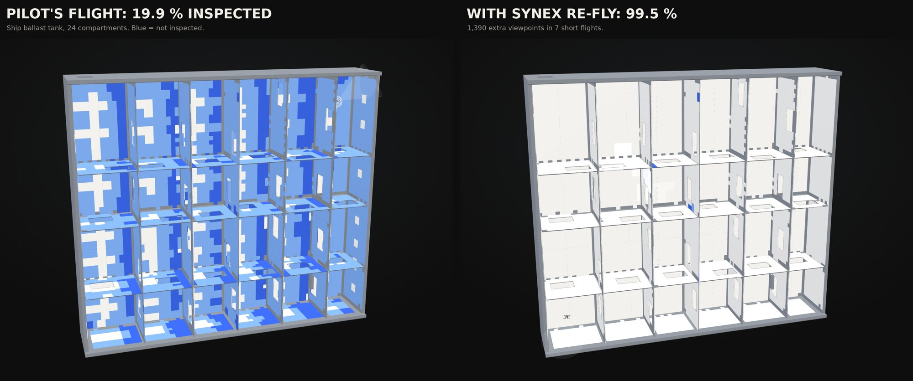
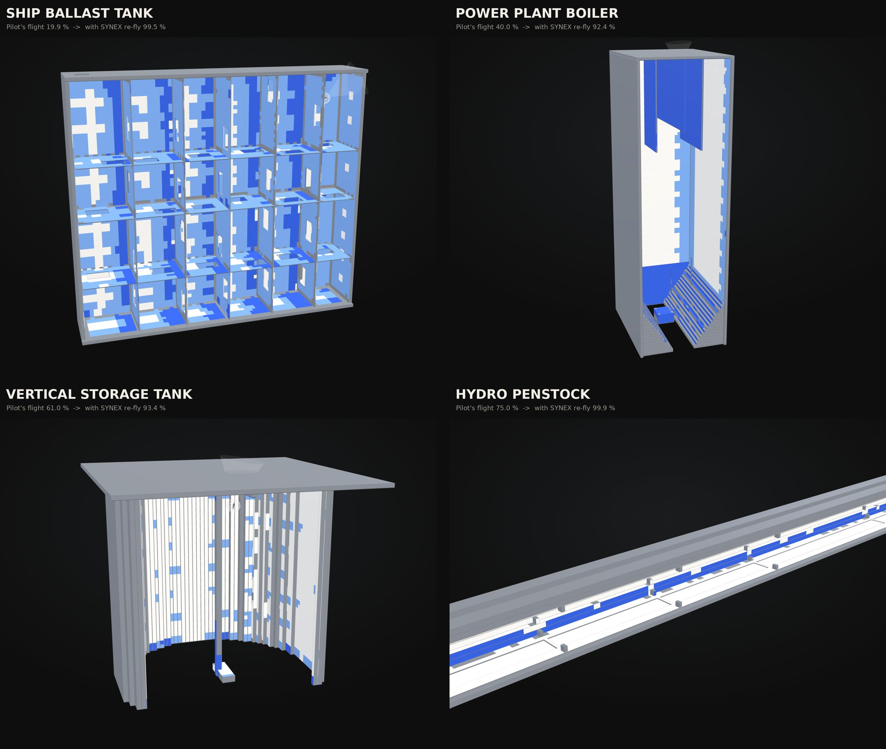
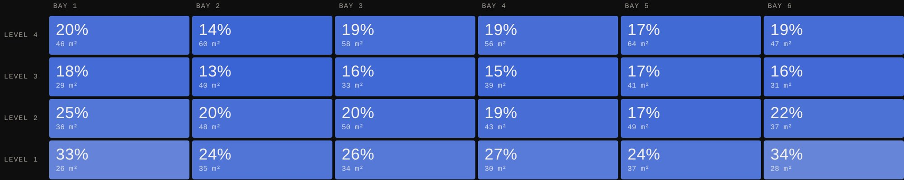
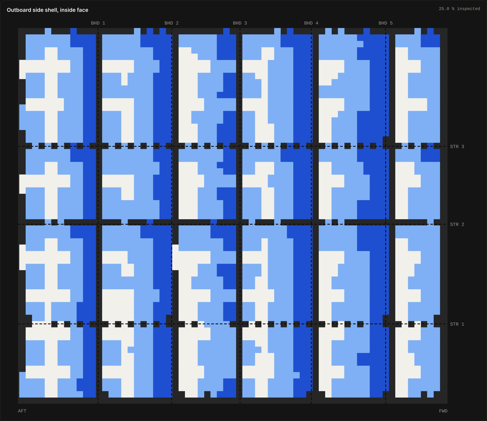

# SYNEX Coverage Check

**Did your drone inspection really see every wall?**

Confined-space flights in ballast tanks, boilers, storage tanks and penstocks end with hours of video and one open question: which walls were actually inspected, and which were only flown past?
SYNEX Coverage Check answers it from the files your drone already records, the point cloud and the flight log, **within 24 hours**.

**[Website & free pilot →](https://mustafabozann.github.io/synex-inspection-plans/)** · **[Open the interactive report →](https://mustafabozann.github.io/synex-inspection-plans/report/)**

*A drone replays the pilot's logged flight inside the tank. A wall turns white only at the moment the camera saw it sharply enough to inspect; blue walls were missed. With the SYNEX re-fly points the gaps close.*

## The problem

- **"In view" is not "inspected".** In this sample, 81 % of the ballast tank was in the camera's view at some point, but only 19.9 % sharply enough to judge the coating (pixel size, angle, motion blur, light).
- **Gaps are invisible in the video.** Nobody can tell from hours of footage which square metres were never seen properly.
- **Finding out later is expensive.** A missed area means another tank entry, another day of downtime, or a defect that stays unseen.

## What you send, what you get

| You send | You get, within 24 hours |
|---|---|
| The point cloud of the space (`.las`, `.laz`, `.e57`, `.ply`, ...) | An interactive 3D report: what was inspected, what was only seen, what was never seen |
| The flight log with camera position and direction (CSV, or a ROS bag) | Coverage per compartment or zone, and unfolded wall maps |
| Your quality standard (default: 1 mm per pixel) | The frame in your own video that proves each inspected area |
| No CAD drawing needed | A re-fly plan: exact positions and camera angles, split into short flights that fit one battery each |

## Four sample structures

| Structure | Wall surface | Pilot's flight, inspection quality | With SYNEX re-fly | Re-fly |
|---|---|---|---|---|
| Ship wing ballast tank (16.9 × 2.8 × 14.8 m, 24 compartments) | 1,037 m² | 19.9 % | **99.5 %** | 7 flights, ~53 min |
| Power plant boiler (7.0 × 9.0 × 23.6 m) | 1,107 m² | 40.0 % | **92.4 %** | 8 flights, ~55 min |
| Vertical storage tank (Ø 10.6 × 11.0 m) | 719 m² | 61.0 % | **93.4 %** | 3 flights, ~19 min |
| Hydro penstock (Ø 2.5 × 75 m) | 640 m² | 75.0 % | **99.9 %** | 3 flights, ~21 min |

Where the re-fly result stays below 100 %, the remaining walls cannot be reached with the drone's safety margin. The report lists them instead of hiding them.

## How to read the report

**Compartments.** One cell per compartment (bay × level) with the share of its walls inspected. Click a cell to fly the 3D view there.

**Wall maps.** The long walls unfolded flat, like a shell expansion drawing, with the transverse bulkheads (BHD) and stringer decks (STR) as dashed lines.

| Part | What it shows | How it is computed |
|---|---|---|
| **Colours** | White: inspected. Light blue: in view, but not sharp enough. Dark blue: never in view. | The wall is cut into 0.5 × 0.5 m patches; a patch counts only when **all** of its check points (up to 5) pass. |
| **Inspection quality** | Whether an image is good enough to judge the surface. | At most 1 mm of wall per pixel at the actual viewing angle, motion blur under 1.5 px (moving and turning), within reach of the drone's lights. All limits are adjustable. |
| **Re-fly plan** | Extra viewpoints (position and camera angle), grouped into short flights. | Routes start and end at the access opening and keep the cage radius plus a safety margin from every surface. |
| **Certain / uncertain** | How much of the result still holds if the logged positions are off by 10 cm and 2°. | The flight is re-checked with random position errors; areas whose result changes go into the re-fly plan. |
| **Viewing angle** | Share of the wall seen at 0–25° (ideal), 25–40° (good) and 40–50° (conditional) off the wall's normal. | Straightest inspection-quality view of each patch. |
| **Provenance** | Software version, date, settings and a SHA-256 fingerprint of every input file. | So every result can be reproduced and audited. |

## Honest status

- All four structures and pilot flights on this page are **simulated**.
- On these structures the engine was compared with the simulator's independent ground truth: of the patches it called inspected, at most 1.1 % were not fully seen.
- It has **not yet been validated on customer field data**. That is what the free trial is for.
- Full coverage means every wall area was imaged at the stated quality. It does not mean every defect was found; the images are still assessed by a qualified inspector.

## Free trial

Send one past flight you are allowed to share (point cloud and flight log, anonymised if needed). You get the full report **within 24 hours, free**. We only ask for your honest feedback: does it match what your inspectors saw?

Request it on the [website](https://mustafabozann.github.io/synex-inspection-plans/#pilot), open an [issue in this repository](../../issues/new), or write to **synex636@gmail.com**. Your data is used only for the analysis and deleted on request.
